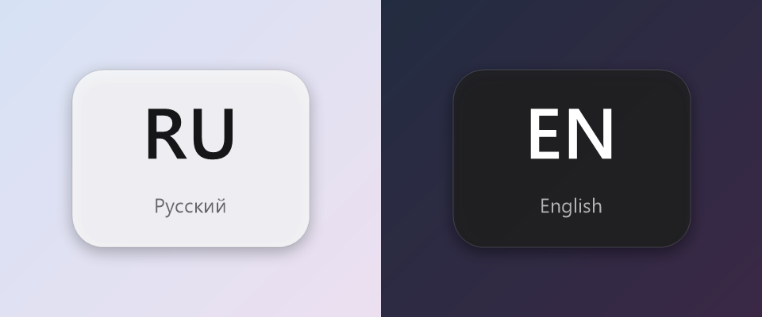

# SwitchPeek

A tiny Windows utility that shows a macOS/GNOME-style keyboard layout indicator in the center of the screen whenever you switch input languages.



Windows only changes a couple of letters in the corner of the taskbar when you switch layouts. SwitchPeek briefly shows a large, clear badge in the middle of the screen (`EN / English`, `RU / Русский`, `UA / Українська`, …) and fades it out, so you always know what you're about to type.

## Features

- **Shows only on a real layout switch.** Moving between windows that have different layouts doesn't trigger it.
- **Works with any switching method:** Alt+Shift, Ctrl+Shift, Win+Space, the language bar, or any language installed in Windows.
- **Theme-aware:** a light or dark badge, matching the system theme.
- **Multi-monitor and DPI-aware:** appears on the monitor with the active window and stays crisp at any scaling.
- **Unobtrusive:** never steals focus, clicks pass through it, and it stays hidden over fullscreen games.
- **Lightweight:** a single small executable with no dependencies and near-zero CPU usage.
- **Simple install:** a per-user installer that needs no admin rights and is listed in *Installed apps* for a clean uninstall.
- **Tray icon** with *Show now*, *Run at Windows startup*, and *Exit*. The menu follows the Windows display language (English, Russian, or Ukrainian).

## Requirements

- Windows 10 or 11
- .NET Framework 4.x (preinstalled on every supported version of Windows)

## Install

Download `SwitchPeekSetup.exe` from [Releases](https://github.com/ypatrin/SwitchPeek/releases) and run it. The installer:

- copies SwitchPeek to `%LOCALAPPDATA%\Programs\SwitchPeek` (no admin rights needed)
- adds a Start menu shortcut and an entry in *Settings → Apps → Installed apps*
- enables **Run at Windows startup** (you can untick it in the installer or toggle it later from the tray menu)
- starts SwitchPeek right away

Running the installer again updates an existing installation in place. For unattended installs, use `SwitchPeekSetup.exe /S`.

**Uninstall:** go to *Settings → Apps → Installed apps → SwitchPeek → Uninstall*. Silent alternative: `SwitchPeek.exe --uninstall --quiet`.

## Build

No Visual Studio or SDK needed. SwitchPeek is compiled with the C# compiler that ships with Windows:

```bat
build.cmd
```

This produces `bin\SwitchPeek.exe` (the app, which you can also run portably from anywhere) and `bin\SwitchPeekSetup.exe` (the installer with the app embedded).

The app icon `assets\SwitchPeek.ico` is generated by `tools\make-icon.ps1`.

## Project layout

| Path | Contents |
|---|---|
| `src/SwitchPeek.cs` | The app: layout polling, overlay rendering, tray, uninstaller |
| `src/Setup.cs` | The installer |
| `src/Shared.cs` | Paths, version, autostart, localization shared by both |
| `assets/SwitchPeek.ico` | App icon |
| `tools/make-icon.ps1` | Icon generator |
| `build.cmd` | Build script |

## Customization

All tunables live at the top of [`src/SwitchPeek.cs`](src/SwitchPeek.cs) in the `Settings` class. Rebuild after changing them. The version number lives in [`src/Shared.cs`](src/Shared.cs).

| Setting | Default | Meaning |
|---|---|---|
| `ShowMs` | `700` | How long the badge stays fully visible (ms) |
| `FadeInMs` / `FadeOutMs` | `70` / `300` | Fade animation duration (ms) |
| `Width` / `Height` | `200` / `150` | Badge size in logical pixels |
| `Radius` | `26` | Corner radius |
| `CodeFontPx` / `NameFontPx` | `60` / `17` | Font size of the language code and name |
| `ShadowSoftness` / `ShadowOffsetY` | `6` / `4` | Shadow blur radius and vertical offset |
| `ShadowAlphaLight` / `ShadowAlphaDark` | `70` / `120` | Shadow opacity in the light and dark themes |
| `PollMs` | `60` | How often the current layout is checked (ms) |
| `IgnoreAfterFocusMs` | `400` | Grace period after a window switch |

To render the badges to PNG files without running the app (handy when tweaking the look):

```bat
bin\SwitchPeek.exe --preview out
```

## How it works

SwitchPeek polls the keyboard layout of the thread that owns the focused window (`GetGUIThreadInfo` + `GetKeyboardLayout`). When the layout changes within the same foreground window, it draws the badge into a per-pixel-alpha layered window (`UpdateLayeredWindow`) that is topmost, click-through, and never activated. The language code and native name come from the layout's language ID via `CultureInfo`.
